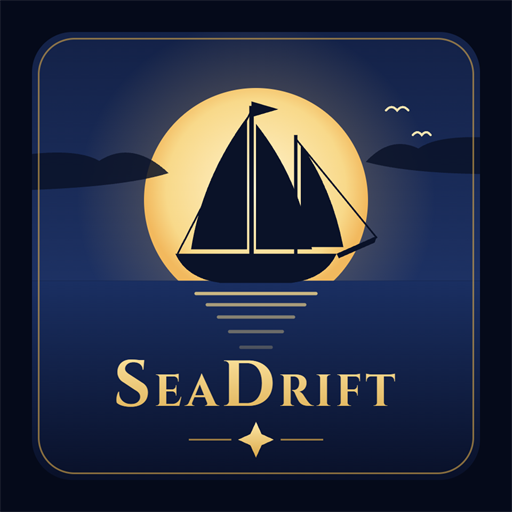
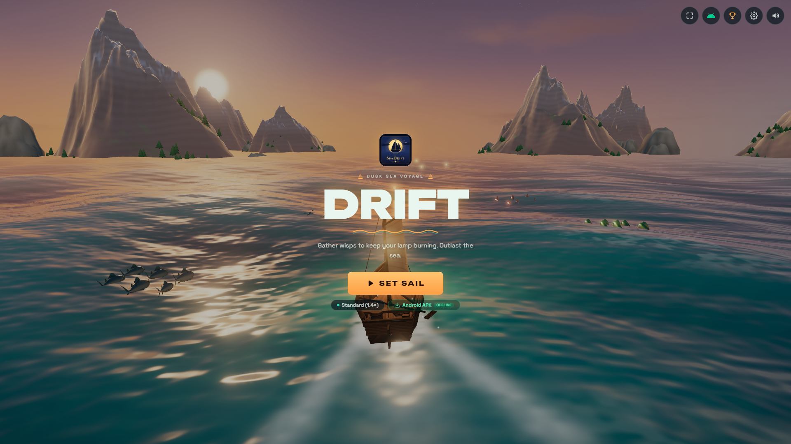

<div align="center">



# SeaDrift · Sail the Dusk Sea

**A quiet, atmospheric 3D voyage across twilight waters.**  
*Gather luminous wisps to keep your bow lantern burning. Outlast the endless sea.*

[](https://github.com/Saif-AlSaad/SeaDrift/actions/workflows/deploy.yml)
[](https://github.com/Saif-AlSaad/SeaDrift/actions/workflows/build-apk.yml)
[](#-android--100-offline-play)
[](#-technology-stack)
[](https://react.dev/)

---

### 🎮 [Play Online in Browser](https://saif-alsaad.github.io/SeaDrift/) &nbsp;·&nbsp; 📱 [Download Android APK](https://github.com/Saif-AlSaad/SeaDrift/releases/latest/download/SeaDrift.apk) &nbsp;·&nbsp; 📦 [GitHub Releases](https://github.com/Saif-AlSaad/SeaDrift/releases)

---



</div>

<br/>

## 🌟 Overview

**SeaDrift** is an endless 3D nautical voyage game built with **Three.js (WebGL 2.0)**, **React 19**, and **Tailwind CSS**. Guided by a single swinging lantern, players navigate across procedural dusk waters, gathering glowing spirits while evading sea obstacles, rogue crests, and rocky hazards.

Whether enjoyed as a meditative drift or an intense reflex challenge, SeaDrift delivers rich graphics, realistic fluid dynamics, dynamic lighting, and immersive spatial audio.

---

## 🌊 Key Features

- **Multi-Directional Gerstner Waves:** High-fidelity procedural ocean swell with sharp wave peaks, realistic crest displacement, and rolling troughs.
- **Wave Subsurface Scattering (SSS):** Golden dusk sunlight naturally penetrates translucent wave crests with emerald and amber rim lighting.
- **Dynamic Marine Ecosystem:** Schools of hammerhead sharks, gliding manta rays, schooling tuna, and glowing bioluminescent jellyfish swim beneath the waves.
- **Atmospheric Dusk & Starfield:** Atmospheric twilight gradient (Belt of Venus), solar corona, dynamic haze, and procedural twinkling stars.
- **Physics-Damped Lantern:** Bow lantern sways in response to boat velocity, wave impacts, and banking angle, casting real-time point-light reflections across the water.
- **Alpine Island Scenery:** Mountain ridges with alpine slopes, evergreen pine clusters, and sea-foam wash lines.
- **Rebalanced Difficulty Modes:**
  - **Calm (1.0×):** Peaceful, meditative voyage with gentle sea swells.
  - **Standard (1.4×):** Balanced challenge with dynamic hazards and rewarding light combos.
  - **Tempest (1.9×):** Fierce storm currents, rapid lamp burn, and testing obstacle densities.

---

## 📱 Android & 100% Offline Play

SeaDrift is fully optimized as an installable, standalone **Android APK** powered by Capacitor:

- **100% Self-Contained:** All 3D procedural shaders, meshes, audio synthesizers, and font assets are packaged inside the APK.
- **No Internet Required:** Play completely offline anywhere, including Airplane Mode.
- **Hardware-Accelerated WebGL 2.0:** Smooth 60 FPS performance on modern mobile GPUs with adaptive DPR scaling.
- **Flexible Controls:** Full support for touch steering (drag or rudder buttons), keyboard/mouse on desktop, and device gyroscope/tilt.

### Installing the Android APK:
1. Download **[SeaDrift.apk](https://github.com/Saif-AlSaad/SeaDrift/releases/latest/download/SeaDrift.apk)** directly onto your Android device.
2. Open the downloaded file in your browser or File Manager.
3. Allow *"Install unknown apps"* if prompted, and launch **SeaDrift**!

---

## 🕹️ Controls

| Control Scheme | Action |
| :--- | :--- |
| **Keyboard** | `A` / `D` or `←` / `→` to Steer |
| **Spacebar** | Quick Lantern Burst / Dash |
| **P / Esc** | Pause / Resume Voyage |
| **R** | Quick Restart |
| **Touch / Mobile** | Drag across screen or tap on-screen rudder buttons |
| **Device Tilt** | Physically tilt your phone (toggleable in Settings) |

---

## 🛠️ Technology Stack

- **Graphics Engine:** [Three.js](https://threejs.org/) (WebGL 2.0 procedural mesh, custom shader uniforms, ACES Filmic tone mapping)
- **UI Framework:** [React 19](https://react.dev/) + [TypeScript](https://www.typescriptlang.org/)
- **Mobile Container:** [Capacitor](https://capacitorjs.com/) (Android native runtime)
- **Styling:** [Tailwind CSS v4](https://tailwindcss.com/)
- **Bundler & Build Tool:** [Vite](https://vitejs.dev/) + `vite-plugin-singlefile`
- **Audio:** Web Audio API procedural synthesizer (ambient wind, gentle wave splashes, lamp chime)

---

## 💻 Local Development

Clone the repository and run the local development server:

```bash
# Clone the repository
git clone https://github.com/Saif-AlSaad/SeaDrift.git
cd SeaDrift

# Install dependencies
npm install

# Start development server
npm run dev

# Build production bundle
npm run build

# Synchronize assets with Android Capacitor project
npm run android:sync
```

---

## 👨‍💻 Author

<div align="center">

### **Saif Al Saad**
**Software Engineering**  
**Daffodil International University**

[](https://github.com/Saif-AlSaad)
[](https://github.com/Saif-AlSaad/SeaDrift)

</div>
